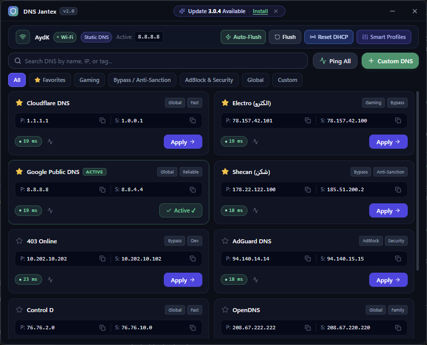

<div align="center">


# DNS Jantex v4.0.2

**Modern, Lightweight Windows DNS & Network Profile Manager**  
*Re-engineered from scratch with Rust (Tauri v2) & React*

[](https://github.com/ZeLoExE/dns-jantex/releases/latest)
[](https://www.virustotal.com/gui/file/d0ab35ba603b53a322efe5886e2905cb1ee47d75340702aa4eb5a27bd30864a7)
[](https://tauri.app)
[](https://www.rust-lang.org)
[](https://react.dev)
[](https://www.microsoft.com/windows)
[](LICENSE)

<br/>



</div>

---

## 🌟 English Overview

**DNS Jantex v4.0.2** is a high-performance Windows desktop application built from the ground up using **Rust** and **Tauri v2**, paired with a sleek **React + TypeScript + Tailwind CSS** frontend.

### ✨ Key Features in v4.0.2
- 🔒 **Mandatory UAC Administrator Manifest:** Automatically prompts for Windows Administrator elevation on launch with UAC shield badge—no manual "Run as administrator" needed.
- 🪟 **Single-Instance Tray Lock & Restore:** If the app is minimized to the System Tray, clicking shortcuts or re-launching restores and focuses the existing window rather than spawning duplicates.
- 🔄 **Direct One-Click Auto-Updater:** Checks GitHub releases in real time, downloads the NSIS installer to `%TEMP%`, and automatically applies updates with a single click.
- ⚡ **Ultra-Lightweight & Fast:** Installer is only **~5.8 MB** (down from ~80 MB in Python!); launches instantaneously with minimal RAM footprint (~40 MB).
- 🎯 **Real DNS UDP Port 53 Ping:** Concurrently tests true DNS lookup round-trip latency over raw UDP sockets (not deceptive ICMP pings) with strict 1.5s timeouts.
- 🔄 **Smart Network Profiles:** Automatically detects Wi-Fi SSID or Ethernet adapter switches and seamlessly applies your saved DNS configurations.
- 🧹 **Zero-Window Silent Auto-Flush:** Flushes the Windows DNS resolver cache silently using background flags without flashing any CMD or PowerShell windows.
- 🛡️ **Captive Portal Guard:** Automatically alerts you if hotel, airport, or cafe captive portal interception is detected on your network connection.
- 🪟 **Compact Frameless Windows 11 UI:** Fixed `840x680` high-density viewport with Mica dark aesthetic, single-row category filters, dual IP copy pills, and custom drag titlebar.
- 📥 **Background Tray Integration:** Closes to the Windows system tray with quick one-click actions ("Reset to DHCP", "Open", "Quit").

---

## 🇮🇷 معرفی فارسی (Persian Overview)

نسخه **DNS Jantex v4.0.2** جدیدترین به‌روزرسانی پایدار برنامه است که با هسته قدرتمند **راست (Rust)** و فریم‌ورک فوق‌سریع **Tauri v2** به همراه رابط کاربری مدرن **React + TypeScript + Tailwind CSS** ارائه شده است.

### ✨ ویژگی‌های کلیدی در نسخه ۴.۰.۲
- 🔒 **اجرای خودکار با دسترسی Administrator (UAC):** برنامه به صورت پیش‌فرض مانیفست استاندارد ادمین داشته و در تمام دفعات اجرا مستقیماً پنجره درخواست دسترسی UAC ویندوز را نمایش می‌دهد (بدون نیاز به کلیک راست و Run as admin).
- 🪟 **قفل تک‌نسخه‌ای و بازیابی از کنار ساعت (Single-Instance):** در صورتی که برنامه در System Tray مخفی باشد، با کلیک مجدد روی آیکون برنامه در دسکتاپ، همان پنجره موجود فراخوانی و فعال می‌شود و از باز شدن نمونه تکراری جلوگیری می‌گردد.
- 🔄 **آپدیتر مستقیم و خودکار:** بررسی انتشار نسخه‌های جدید در گیت‌هاب، دانلود مستقیم فایل نصبی در پس‌زمینه و اجرای خودکار فرآیند ارتقا تنها با یک کلیک.
- ⚡ **حجم فوق‌العاده کم و سرعت بی‌نظیر:** حجم فایل نصبی تنها **۵.۸ مگابایت** با مصرف رم بسیار بهینه (~۴۰ مگابایت).
- 🎯 **تست پینگ واقعی DNS از پورت ۵۳ (UDP):** اندازه‌گیری تأخیر واقعی با ارسال کوئری به پورت ۵۳ سرورها (به‌جای پینگ گمراه‌کننده ICMP) به صورت همزمان.
- 🔄 **پروفایل‌های هوشمند شبکه:** شناسایی خودکار نام شبکه Wi-Fi (SSID) یا آداپتور اترنت و تنظیم خودکار DNS متناسب با آن شبکه.
- 🧹 **فلاش خودکار بدون پرش پنجره:** پاکسازی کش DNS ویندوز بدون باز شدن هیچ‌گونه پنجره سیاه CMD یا پاورشل.
- 🛡️ **تشخیص صفحات لاگین عمومی (Captive Portal Guard):** هشدار هوشمند در صورت قرار گرفتن در شبکه هتل یا کافه برای جلوگیری از قطعی اتصال.
- 🪟 **طراحی مدرن و کامپکت ویندوز ۱۱:** رابط کاربری فریم‌لس شیشه‌ای در ابعاد بهینه، بدون اسکرول سراسری و با دسترسی فوق سریع به سرورهای گیمینگ، ضدتحریم و امنیت.

---

## 🔒 Security, VirusTotal & Why Administrator Privileges? | شفافیت امنیتی، ویروس‌توتال و دسترسی ادمین

### 🇬🇧 English
- **Why Administrator Privileges?** Modifying Windows network adapter DNS addresses natively requires Windows Administrator privileges. DNS Jantex only requests elevation to configure your network adapter DNS table via standard Windows network commands (`netsh` / PowerShell `Set-DnsClientServerAddress`) and flush the system resolver cache.
- **100% Open-Source & Transparent:** Because DNS tools manage critical internet routing parameters, DNS Jantex is completely open-source under GNU GPLv3. Every line of backend Rust and frontend React code is published right here for anyone to inspect and audit.
- **Windows SmartScreen Note:** Fresh releases of independent open-source tools without multi-thousand-dollar corporate EV code-signing certificates may trigger a Windows SmartScreen warning (*"Windows protected your PC"*). This is completely normal for new community software. You can safely click **"More info"** &rarr; **"Run anyway"**. You can independently verify the binary integrity using the SHA-256 hashes and VirusTotal analysis below.

### 🇮🇷 فارسی
- **دلیل نیاز به دسترسی Administrator:** در سیستم‌عامل ویندوز، تغییر آی‌پی سرورهای DNS هر کارت شبکه ذاتاً نیازمند دسترسی ادمین است. این برنامه تنها برای ثبت سرورها از طریق دستورات بومی شبکه ویندوز (`netsh` / `Set-DnsClientServerAddress`) و پاکسازی کش DNS از این دسترسی استفاده می‌کند.
- **شفافیت کامل و متن‌باز:** با توجه به اهمیت امنیت ترافیک اینترنت، تمام سورس‌کد پروژه تحت لایسنس بین‌المللی GPLv3 به صورت ۱۰۰٪ عمومی و متن‌باز در دسترس است تا هر کاربری بتواند کارکرد امن آن را بررسی و ممیزی کند.
- **پیام Windows SmartScreen:** به دلیل هزینه چند هزار دلاری گواهی‌های تجاری EV در ویندوز، نرم‌افزارهای مستقل متن‌باز در اولین اجراها ممکن است با اخطار SmartScreen ویندوز مواجه شوند. این موضوع طبیعی بوده و می‌توانید با زدن **More info** و سپس **Run anyway** برنامه را اجرا کنید. همچنین با تطبیق چک‌سام SHA-256 و گزارش ویروس‌توتال زیر می‌توانید از اصالت و سلامت کامل فایل اطمینان حاصل کنید.

---

## 📦 Downloads, Checksums & VirusTotal Scans | دانلود، هش‌ها و اسکن ویروس‌توتال

Official releases are hosted exclusively on the [GitHub Releases](https://github.com/ZeLoExE/dns-jantex/releases/latest) page. You can also download the signed checksum manifest [checksums.sha256.txt](https://github.com/ZeLoExE/dns-jantex/releases/download/v4.0.2/checksums.sha256.txt):

| Package | Description | Size | SHA-256 Checksum | VirusTotal Report |
| :--- | :--- | :--- | :--- | :--- | :---: |
| **`DNS-Jantex-v4.0.2-Setup.exe`** | Official Windows NSIS Installer (Recommended) | ~8.37 MB | `d0ab35ba603b53a322efe5886e2905cb1ee47d75340702aa4eb5a27bd30864a7` | [🛡️ View VirusTotal Scan](https://www.virustotal.com/gui/file/d0ab35ba603b53a322efe5886e2905cb1ee47d75340702aa4eb5a27bd30864a7) |
| **`DNS-Jantex-v4.0.2-Portable.exe`** | Standalone Portable (No install needed) | ~14.9 MB | `287e28684732a67d38ac5f38ade97e677cf3774399d1d2e9a98869e744a466a1` | [🛡️ View VirusTotal Scan](https://www.virustotal.com/gui/file/287e28684732a67d38ac5f38ade97e677cf3774399d1d2e9a98869e744a466a1) |
| **`DNSJantex-Setup.exe`** | Legacy auto-updater compatible package | ~8.37 MB | `d0ab35ba603b53a322efe5886e2905cb1ee47d75340702aa4eb5a27bd30864a7` | [🛡️ View VirusTotal Scan](https://www.virustotal.com/gui/file/d0ab35ba603b53a322efe5886e2905cb1ee47d75340702aa4eb5a27bd30864a7) |

### Verify Checksum on your PC (PowerShell):
```powershell
Get-FileHash -Path "DNS-Jantex-v4.0.2-Setup.exe" -Algorithm SHA256
```

---

## 🛠️ Development & Building from Source

### Prerequisites
- [Node.js](https://nodejs.org/) (v18+ or v20+ LTS)
- [Rust](https://rustup.rs/) (stable toolchain `stable-x86_64-pc-windows-msvc`)
- Visual Studio C++ Build Tools (MSVC)
- WebView2 Runtime (Preinstalled on Windows 10/11)

### Setup & Run
```bash
# Clone the repository
git clone https://github.com/ZeLoExE/dns-jantex.git
cd dns-jantex

# Install frontend dependencies
npm install

# Run in development mode
npm run tauri dev

# Build production NSIS installer & binary
npm run tauri build
```

---

## 📄 License & Attribution

This project is licensed under the **GNU General Public License v3.0 (GPL-3.0)**.  
Copyright (C) 2026 **ZeLoExE**.

Under the terms of the GNU GPLv3:
- You are free to run, copy, distribute, study, and modify this software.
- If you modify or redistribute this software (or any derived work), your modifications **MUST** remain free and open-source under the same GPL-3.0 license.
- Proper credit and attribution to the original author (**ZeLoExE**) must always be preserved.

See the full [LICENSE](LICENSE) file for complete terms and conditions.
